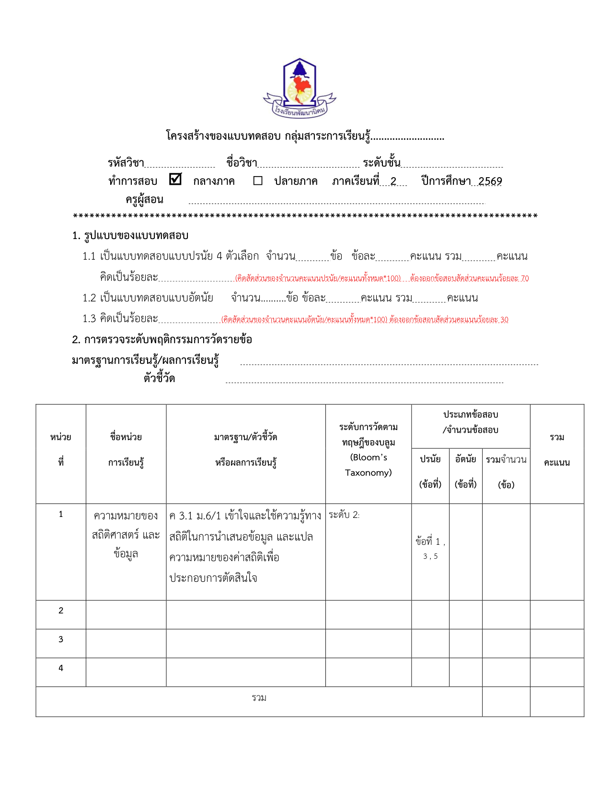
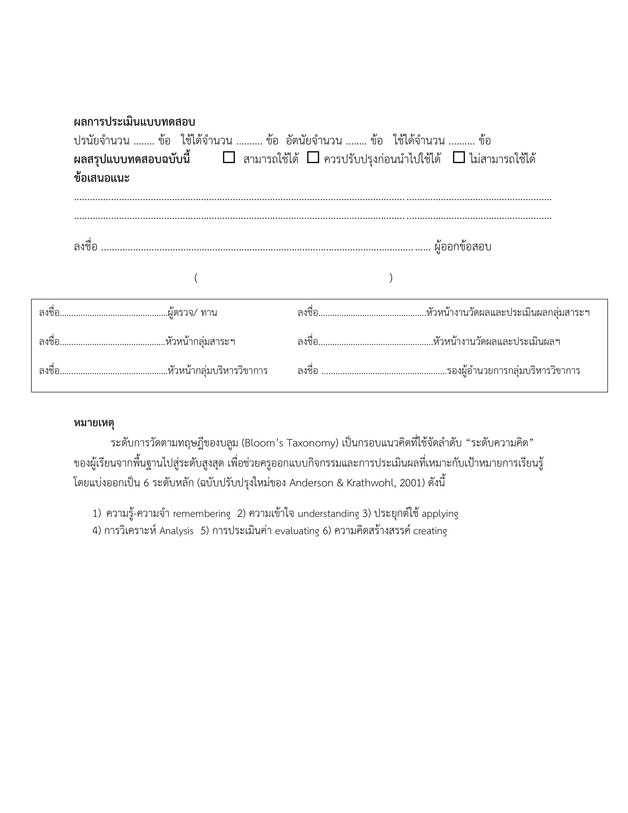
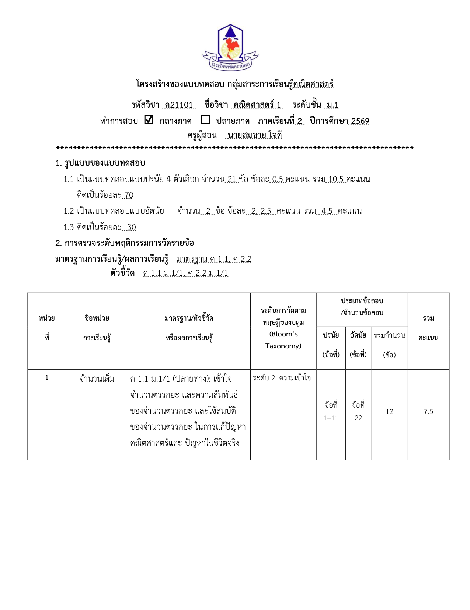
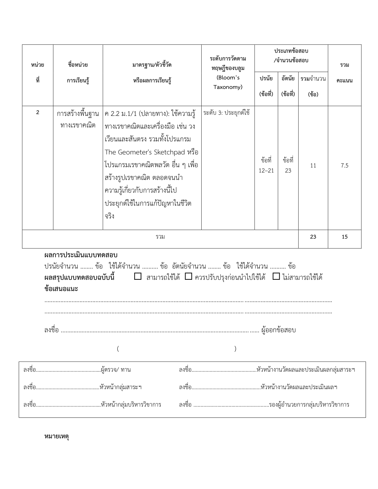
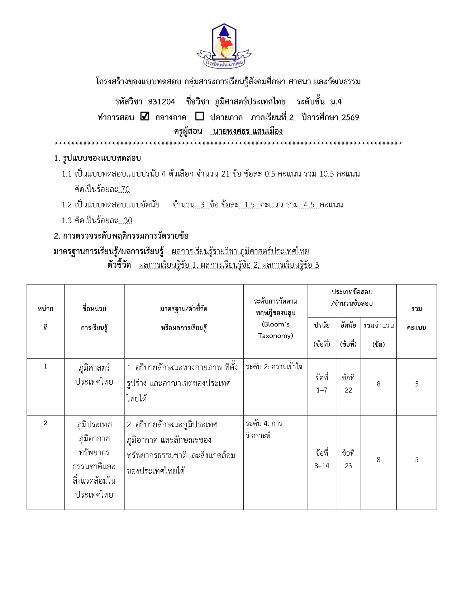
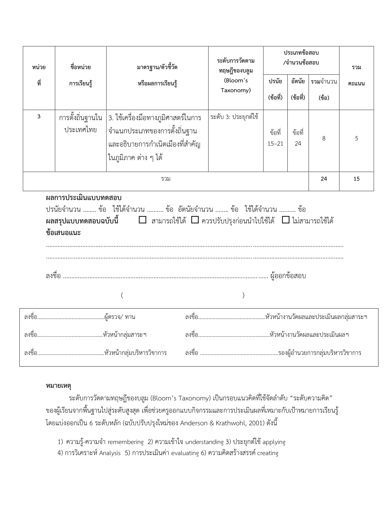
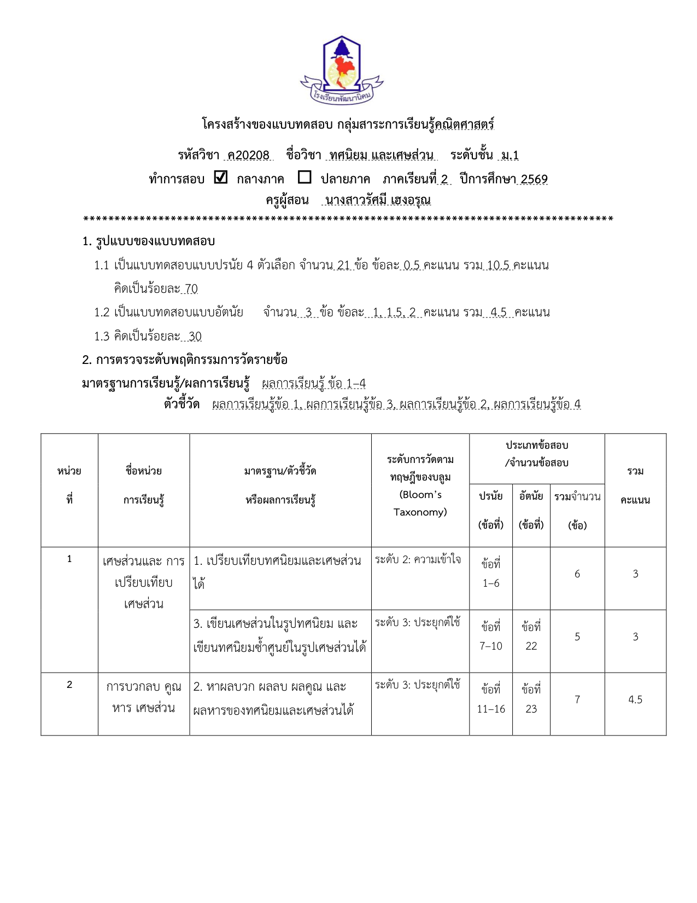
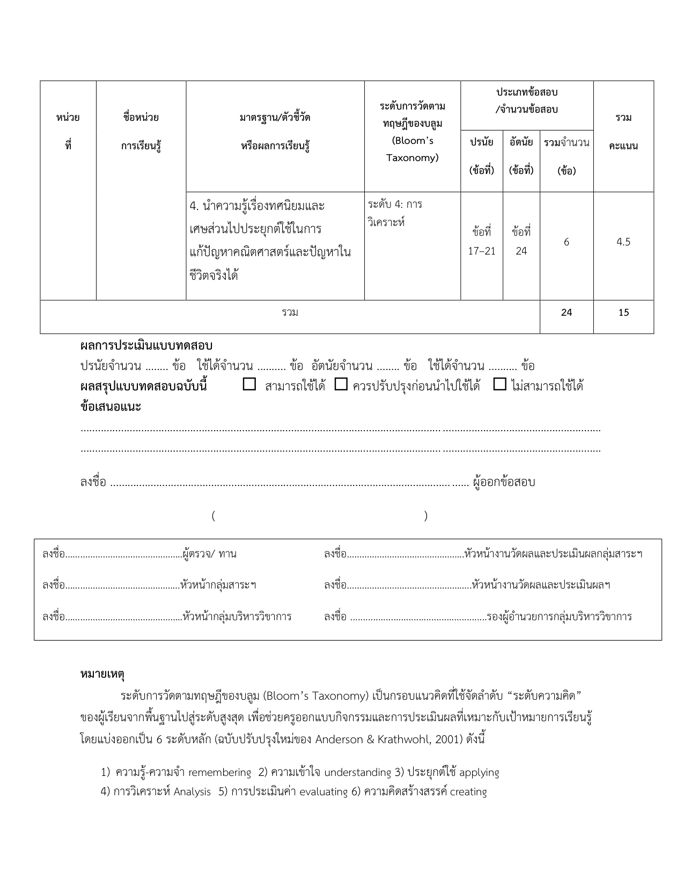
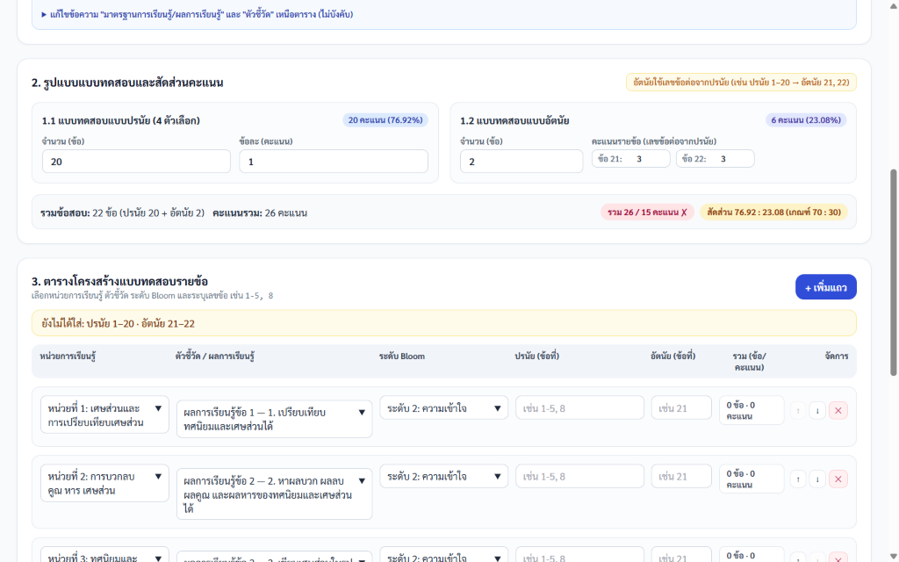
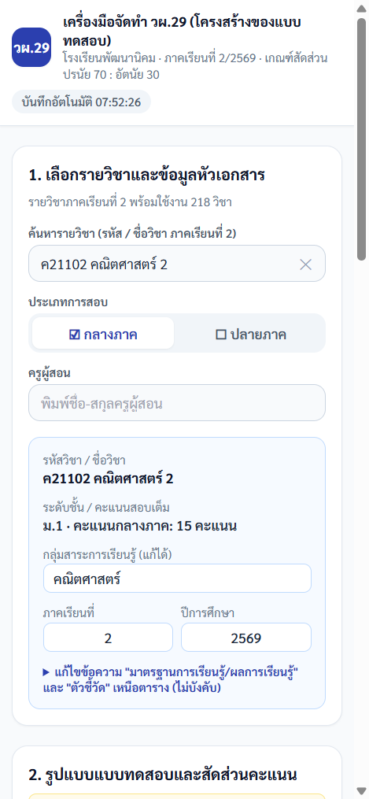

# REPORT_AGY_R1 — รายงานผลการพัฒนาเครื่องมือจัดทำ วผ.29 (โครงสร้างของแบบทดสอบ)

> สถานะรุ่น: **Beta** (`main` commit `442d3cf8` · GitHub Pages: https://cutoutppp.github.io/AssessmentHub/TestBlueprint/)  
> วันที่ดำเนินการ: 20 พฤศจิกายน 2569  
> สเปคอ้างอิง: [SPEC_AGY_R1.md](SPEC_AGY_R1.md)

---

## 1. สรุปไฟล์ที่สร้าง (ทั้งหมดอยู่ใน `AssessmentHub/TestBlueprint/`)

| ไฟล์ | หน้าที่ |
|---|---|
| `index.html` | หน้าเว็บ single-page (Tailwind CDN, ฟอนต์ Sarabun, JSZip 3.10.1, FileSaver 2.0.5) เชื่อมโยงข้อมูลจาก `../assessment-plan/data/courses_2_2569.js` และ `../assessment-plan/data/teacher_directory.js` และลิงก์ข้ามกับ `../assessment-plan/index.html` |
| `js/config.js` | ค่าตั้งเกณฑ์ `RATIO = { objective: 70, subjective: 30 }`, `RATIO_TOLERANCE = 0`, `DEFAULT_TERM = '2'`, `DEFAULT_YEAR = '2569'`, ชื่อระดับ Bloom 6 ระดับ |
| `js/courses.js` | `cleanIndicatorText()`, `parseIndicator()`, `indicatorShortLabel()`, `unitsInRange()`, `indicatorsForUnit()`, `resolveUnitIndicators()`, `resolveTeacher()`, `validCourseTeachers()`, `mergeAssessmentPlanOverrides()`, `filterCourses()` |
| `js/model.js` | `parseItemRange()`, `formatItemRange()`, `calcRowMetrics()`, `calcDraftSummary()`, `validate()` ครบทุก code ในข้อ 4 |
| `js/export_wp29.js` | `buildDocumentXml()`, `generateWp29Docx()`, `downloadWp29Docx()`, `exportFilename()` รองรับ vMerge, XML escaping, สัดส่วนคะแนนอัตนัยไม่เท่ากัน, แทนที่ placeholder ครบถ้วน |
| `js/app.js` | UI state, เชื่อมโยงระบบแผนวัดผล (รวม snapshot จาก Firebase `survey_config` ครบ 218 วิชาใน `data/assessment_plan_sync.js` + ซ้อนค่าแก้ไขล่าสุดใน `localStorage`, แสดงเวลาสอบ/สถานะยืนยัน/ห้องสอน/คะแนนเก็บ), ดึงหน่วย+ตัวชี้วัดในช่วงสอบใส่ตารางอัตโนมัติ, live missing-items bar, debounced validator (300ms) |
| `data/assessment_plan_sync.js` | ข้อมูลสรุปแผนวัดผล 2/2569 จาก Firestore `survey_config` ครบ 218 วิชา (~469 KB) พร้อมใช้ทันทีไม่ต้องรอซิงก์ |
| `tools/pull_firebase_plan.py` | สคริปต์ดึงข้อมูลล่าสุดจาก Firestore `survey_config` มาอัปเดต `data/assessment_plan_sync.js` |
| `templates/wp29_template.docx` | แม่แบบที่ตัดจาก `วผ29 โครงสร้างของแบบทดสอบ-3.docx` เฉพาะส่วน วผ.29 (ตราโรงเรียน → หมายเหตุ Bloom) พร้อม placeholder 29 จุดใน `<w:r>` เดี่ยว, 1 แถวต้นแบบ (`<w:cantSplit/>`) + แถวรวม |
| `templates/wp29_template_b64.js` | แม่แบบเข้ารหัส Base64 (54,148 chars) สำหรับเปิดใช้งานผ่าน `file://` |
| `tools/build_template.py` | สคริปต์สร้าง `templates/wp29_template.docx` จากไฟล์ต้นฉบับ |
| `tools/build_template_b64.py` | สคริปต์แปลง `templates/wp29_template.docx` → `templates/wp29_template_b64.js` |
| `tests/courses.test.mjs`, `tests/model.test.mjs`, `tests/export_wp29.test.mjs` | ชุดทดสอบ `node --test` |
| `tests/fixtures/math_k21101_mid.json`, `social_s31204_mid.json`, `elective_k20208_mid.json` | ข้อมูลทดสอบ 3 ชุดตามเกณฑ์ข้อ 7.2 |

---

## 2. ผลการทดสอบตามเกณฑ์ข้อ 7

### 2.1 Unit Tests (`node --test`)

> หมายเหตุบน Windows PowerShell / Node v24.22.1: คำสั่ง `node --test tests/` มอง `tests` เป็นชื่อโมดูล จึงรันด้วย `node --test tests/*.test.mjs` ภายใน `AssessmentHub/TestBlueprint`

```text
AssessmentHub/TestBlueprint> node --test tests/*.test.mjs
✔ cleanIndicatorText joins spaced Thai letters without merging normal words (1.0437ms)
✔ parseIndicator parses basic and elective indicators (2.6872ms)
✔ unitsInRange handles MID, FINAL, and missing cutoff (0.4179ms)
✔ indicatorsForUnit prefers unit indicators and falls back to course indicators (0.5721ms)
✔ assessment-plan linkage helpers resolve teachers, filter courses, and merge overrides (1.0825ms)
✔ resolveUnitIndicators resolves bound unit indicators, plan outcome_nos, and suggested mapping (0.5745ms)
✔ buildDocumentXml fills all placeholders cleanly with XML escaping and vMerge (8.1792ms)
✔ exportFilename follows วผ29_<code >_<exam>_<term>-<year>.docx format (0.2891ms)
✔ parseItemRange parses normal, en-dash, spaces, Thai digits, and rejects invalid ranges (1.9906ms)
✔ formatItemRange compacts contiguous runs and singletons (0.2865ms)
✔ validate passes cleanly on all 3 realistic fixtures (2.9514ms)
✔ validate triggers and clears every error/warn code in section 4 (5.5012ms)
✔ suggestRatioPresets generates exact 70:30 combinations for 10, 15, and 20 point exams (0.674ms)
ℹ tests 13
ℹ suites 0
ℹ pass 13
ℹ fail 0
ℹ cancelled 0
ℹ skipped 0
ℹ todo 0
ℹ duration_ms 187.182
```

### 2.2 การสร้างแม่แบบและตรวจ Placeholder

```text
Built: AssessmentHub/TestBlueprint/templates/wp29_template.docx
Wrote AssessmentHub/TestBlueprint/templates/wp29_template_b64.js (54148 base64 chars)
Placeholders found: ['{{learning_area}}', '{{course_code}}', '{{course_name}}', '{{grade_level}}', '{{mid_box}}', '{{fin_box}}', '{{term}}', '{{year}}', '{{teacher_name}}', '{{obj_count}}', '{{obj_each}}', '{{obj_total}}', '{{obj_pct}}', '{{subj_count}}', '{{subj_each}}', '{{subj_total}}', '{{subj_pct}}', '{{standard_text}}', '{{indicator_text}}', '{{unit_no}}', '{{unit_name}}', '{{row_indicator}}', '{{row_bloom}}', '{{row_obj}}', '{{row_subj}}', '{{row_count}}', '{{row_score}}', '{{total_count}}', '{{total_score}}']
Placeholders inside single <w:t>: 29 == 29
```

### 2.3 การส่งออก .docx จาก Fixture 3 ชุด และเปิดผ่าน Microsoft Word

- ยืนยัน `word/document.xml` ของทุกไฟล์ไม่มี `{{` หรือ `}}` หลงเหลือ
- เปิดทุกไฟล์ผ่าน Microsoft Word COM (`DisplayAlerts = 0`, `ReadOnly = True`) และแปลงเป็น PDF → PNG ได้สำเร็จโดยไม่มีข้อความแจ้งซ่อมไฟล์

```text
Generated XML: ...\math_k21101_mid.xml -> filename: วผ29_ค21101_กลางภาค_2-2569.docx
Generated XML: ...\social_s31204_mid.xml -> filename: วผ29_ส31204_กลางภาค_2-2569.docx
Generated XML: ...\elective_k20208_mid.xml -> filename: วผ29_ค20208_กลางภาค_2-2569.docx
orig: 4 pages, saved p3 & p4
math_k21101_mid: 3 page(s)
social_s31204_mid: 2 page(s)
elective_k20208_mid: 2 page(s)

Browser-downloaded docx XML verified clean (no {{ or }}), size: 41030
Opened browser-downloaded docx in Word cleanly! Pages: 2
```

*(หมายเหตุ: ชุดที่ 2 และชุดที่ 3 จบใน 2 หน้าพอดีเหมือนต้นฉบับหน้า 3–4 ส่วนชุดที่ 1 ตัวชี้วัดหน่วยที่ 2 ยาว 9 บรรทัดจึงขึ้นหน้า 3 เฉพาะ 2 บรรทัดท้ายของหมายเหตุ — ตัวแถวตารางไม่ถูกตัดกลางแถวเนื่องจากตั้ง `<w:cantSplit/>` และหัวตารางซ้ำอัตโนมัติทุกหน้าด้วย `<w:tblHeader/>`)*

---

## 3. ภาพเปรียบเทียบเอกสารส่งออกกับต้นฉบับหน้า 3–4

### ต้นฉบับ (`วผ29 โครงสร้างของแบบทดสอบ-3.docx` หน้า 3–4)

| ต้นฉบับ หน้า 3 (หัวเอกสาร + ตาราง) | ต้นฉบับ หน้า 4 (ผลการประเมิน + ลงนาม + หมายเหตุ Bloom) |
|---|---|
|  |  |

### ชุดที่ 1: `ค21101` คณิตศาสตร์ 1 กลางภาค (มีตัวชี้วัดผูกหน่วย)

- ปรนัย 21 ข้อ ข้อละ 0.5 คะแนน (รวม 10.5 = ร้อยละ 70) · อัตนัย 2 ข้อ ข้อละ 2, 2.5 คะแนน (รวม 4.5 = ร้อยละ 30) · รวม 15 คะแนน

| หน้า 1 | หน้า 2 | หน้า 3 (ท้ายหมายเหตุ) |
|---|---|---|
|  |  |  |

### ชุดที่ 2: `ส31204` ภูมิศาสตร์ประเทศไทย กลางภาค (วิชาสังคมที่ไม่มีตัวชี้วัดผูกหน่วย)

- ใช้ตัวชี้วัดระดับรายวิชา · ปรนัย 21 ข้อ ข้อละ 0.5 คะแนน · อัตนัย 3 ข้อ ข้อละ 1.5 คะแนน (แสดงค่าเดียว `"1.5"`) · รวม 15 คะแนน

| หน้า 1 | หน้า 2 |
|---|---|
|  |  |

### ชุดที่ 3: `ค20208` ทศนิยม และเศษส่วน กลางภาค (เพิ่มเติม + อัตนัยไม่เท่ากัน + vMerge หลายแถวต่อหน่วย)

- แสดง `"ผลการเรียนรู้ข้อ 1, ผลการเรียนรู้ข้อ 3, ผลการเรียนรู้ข้อ 2, ผลการเรียนรู้ข้อ 4"` อัตโนมัติเหนือตาราง
- อัตนัยข้อละ `"1, 1.5, 2"` (คะแนนรายข้อไม่เท่ากัน)
- ผสานเซลล์แนวตั้ง (`vMerge`) บนคอลัมน์ "หน่วยที่" และ "ชื่อหน่วย" สำหรับหน่วยที่ 1 (2 แถว) และหน่วยที่ 2 (2 แถว)

| หน้า 1 | หน้า 2 |
|---|---|
|  |  |

---

## 4. ผลการทดสอบหน้าเว็บ (ข้อ 7.3)

1. **เปิดจาก local server (`http://127.0.0.1:8765` / `8766`):** โหลดสำเร็จ HTTP 200, Console error = 0, แสดง `รายวิชาภาคเรียนที่ 2 พร้อมใช้งาน 218 วิชา`
2. **เปิดจาก `file://` (Microsoft Edge Headless):**
   ```text
   msedge file:// exit: 0
   msedge file:// courseCountHint: รายวิชาภาคเรียนที่ 2 พร้อมใช้งาน 218 วิชา
   ```
3. **การเชื่อมโยงกับระบบแผนวัดผล (วผ.19) และนำปุ่ม JSON ออก:**
   - ทดสอบเปิด `?teachcode=236` (`http://127.0.0.1:8767/TestBlueprint/index.html?teachcode=236`) → ระบบเลือกกลุ่มสาระ `คณิตศาสตร์`, ครู `[236] นางสาวรัศมี เฮงอรุณ`, เติมชื่อครูอัตโนมัติ และดึงรายวิชาที่สอน 4 วิชา (`ค20208`, `ค20214`, `ค21102`, `ค21202`)
   - เมื่อเลือกรายวิชาใหม่ (ยังไม่มี draft ใน localStorage) ระบบดึงทั้ง **หน่วยในช่วงสอบ** และ **ตัวชี้วัด/ผลการเรียนรู้ที่ผูกกับหน่วย** มาสร้างแถวในตารางให้อัตโนมัติทันที (`resolveUnitIndicators()`: ใช้ `unit.indicators` ก่อน → `unit.outcome_nos` จากแผนวัดผล → กระจายตามลำดับหน่วยแบบเดียวกับ `assessment-plan` สำหรับวิชาที่หน่วยไม่ได้ผูกตัวชี้วัดไว้ล่วงหน้า) พร้อมแสดงรายชื่อตัวชี้วัดที่ผูกในการ์ดโครงสร้างรายวิชา (ทดสอบจริงกับทั้ง `ค21102` ที่ผูกหน่วยไว้แล้ว และ `ค20208` ที่แนะนำตามหน่วย 1–3)
   - ลิงก์ `ระบบแผนวัดผล (วผ.19) ↗` อัปเดตเป็น `../assessment-plan/index.html?code=%E0%B8%8420208` อัตโนมัติ
   - ยืนยันไม่มีปุ่ม `ส่งออกไฟล์งาน (.json)` / `นำเข้า (.json)` ในหน้าเว็บแล้ว
   - กด `ดาวน์โหลด วผ.29 (.docx)` (ทดสอบกับ `ค21102`) ได้ไฟล์ `วผ29_ค21102_กลางภาค_2-2569.docx` (41,030 bytes) เปิดใน Microsoft Word ได้ 2 หน้าไม่มี error
   - ทดสอบโหลดข้อมูลแผนวัดผลในเครื่องจาก `data/assessment_plan_sync.js` บน `file://` (Microsoft Edge Headless กับ `?code=I30202`, ไม่ต้องรอซิงก์เครือข่าย):
     ```text
     firebaseSyncBadge -> ✓ แผนวัดผลครบ 218 วิชา (พร้อมใช้ทันที)
     metaGradeScore -> ม.5 · กลางภาค: 10 คะแนน · เวลาสอบ 60 นาที
     metaPlanExtra -> แผนวัดผล: ✓ ยืนยันแล้ว (นางสาววิรัญญา จึงจรรยา)
     ```
     (ค่าคะแนนเต็มกลางภาคของ `I30202` ใช้ `10` คะแนน และเวลาสอบ `60` นาที ตามที่ครูยืนยันในแผนวัดผลทันที ทำงานออฟไลน์ 100%)
4. **Responsive Layout (เดสก์ท็อป 1280×800 และมือถือ 375×812):**
   - เดสก์ท็อป (1280×800): `html`/`body`/`header`/`main` width = `1264.8px <= 1280px` (`overflow = []`)
   - มือถือ (375×812): `html`/`body`/`header`/`main` width = `360px <= 375px` (`overflow = []`) — **ไม่มี scroll แนวนอน**

| หน้าจอเดสก์ท็อป (1280×800) | หน้าจอมือถือ (375×812) |
|---|---|
|  |  |

---

## 5. สถานะ Git และการเผยแพร่รุ่น Beta

- เผยแพร่เฉพาะโฟลเดอร์ `TestBlueprint/` (37 ไฟล์) ขึ้น GitHub (`https://github.com/cutoutppp/AssessmentHub.git`, branch `main`) ที่ commit `442d3cf8`
- ไม่มีการแก้ไขไฟล์ใน `assessment-plan/`, `ioc-system/`, หรือ `TeacherHub-Backend/`
- ลิงก์ใช้งานรุ่น Beta (GitHub Pages): https://cutoutppp.github.io/AssessmentHub/TestBlueprint/

---

## 6. บันทึกรุ่น Beta และการตรวจสอบข้อมูลรั่วไหล (Security / Privacy Audit)

### 6.1 การปรับปรุงเพิ่มเติมในรุ่น Beta
- เพิ่มไกด์และปุ่มเลือกชุดสัดส่วน **70 : 30** อัตโนมัติในขั้นตอนที่ 2 (`suggestRatioPresets()` และ `#ratioGuideBox`) รองรับคะแนนสอบเต็มของแต่ละรายวิชา (เช่น เต็ม 10 คะแนน → `ปรนัย 7 + อัตนัย 3`, เต็ม 15 คะแนน → `ปรนัย 10.5 + อัตนัย 4.5`)
- แสดง **คะแนนสอบกลางภาคและปลายภาค** ชัดเจนทุกจุดในขั้นตอนที่ 1 (`#filterCourseSelect`, ปุ่ม `#examMidBtn`/`#examFinalBtn`, `#metaGradeScore`, และป้าย `#metaPlanExtra`) ครบทั้ง 218 รายวิชาภาคเรียนที่ 2/2569 โดยไม่ดึงคะแนนสอบรายหน่วยมาปะปน

### 6.2 ผลการสแกนความปลอดภัยและข้อมูลที่เผยแพร่ใน `TestBlueprint/`
- **Secret / Credential / PII อ่อนไหว:** **ไม่พบ** API key, token, password, private key, อีเมล, เบอร์โทรศัพท์, เลขบัตรประชาชน 13 หลัก หรือข้อมูลนักเรียนในไฟล์ใด ๆ ของ `TestBlueprint/`
- **ข้อมูลที่เปิดเผยตามลักษณะระบบโรงเรียน (Public Repo Scope):**
  - `data/assessment_plan_sync.js`: มีรายชื่อครูผู้สอน (`teachers`, `confirmed_by`), เวลาที่ยืนยัน (`confirmed_at`), รหัสวิชา/ชื่อหน่วย/ตัวชี้วัด/คะแนนและเวลาสอบ (ขอบเขตเดียวกับ `assessment-plan/data/teacher_directory.js` และ `courses_2_2569.js` ที่อยู่บน GitHub อยู่แล้ว)
  - `tools/pull_firebase_plan.py`: มีชื่อโปรเจกต์ Firestore (`tradesimschool`) ไม่มี API key หรือ credential ใด ๆ (ชื่อโปรเจกต์เดียวกับที่มีอยู่ใน `assessment-plan/index.html` และ `index.html` อยู่แล้ว)
- **Local Windows Paths:** ล้าง path เครื่องพัฒนา (`C:\Users\...`) ที่เคยติดอยู่ในบันทึก Terminal ของรายงานนี้ให้เป็น relative path แล้วทั้งหมด
